# paper-figure

## Redrawing a paper's figures

All data figures from [Understanding R1-Zero-Like Training: A Critical Perspective](https://arxiv.org/abs/2503.20783) (Liu et al., 2025; CC BY 4.0), left, redrawn with this skill, right. Values are read off the original figures, except Fig. 2, whose numbers are printed on the bars. Both sides are scaled by printed width: the full text width (original) and double column (ours) are 400 px.

| Fig. | Original | Ours |
|---|---|---|
| 2 | 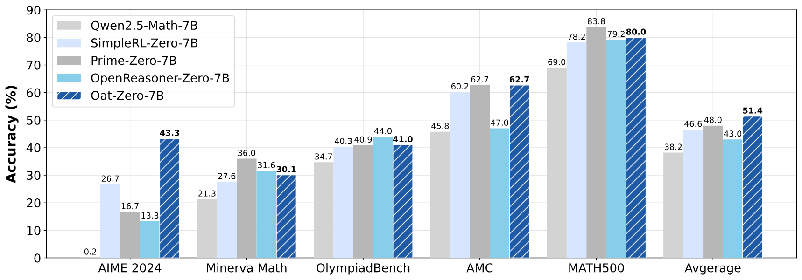 | 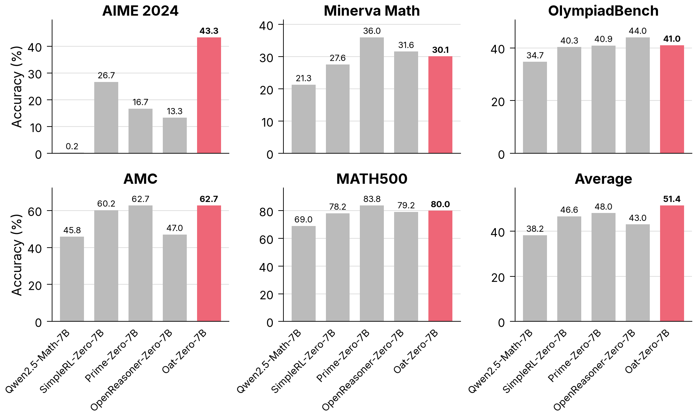 |
| 5 | 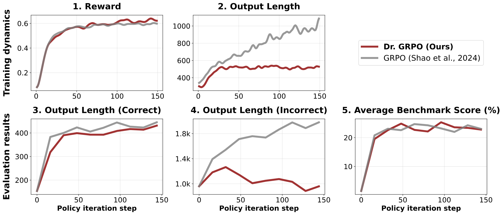 | 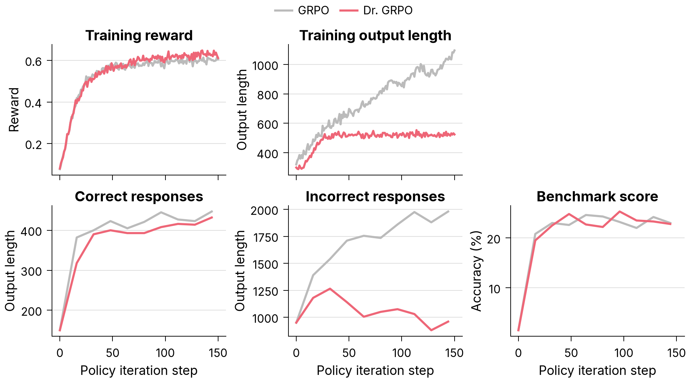 |
| 7 | 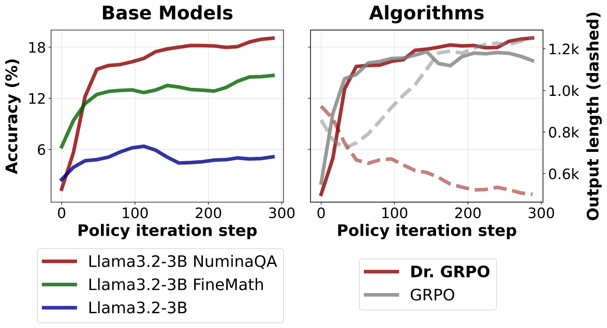 | 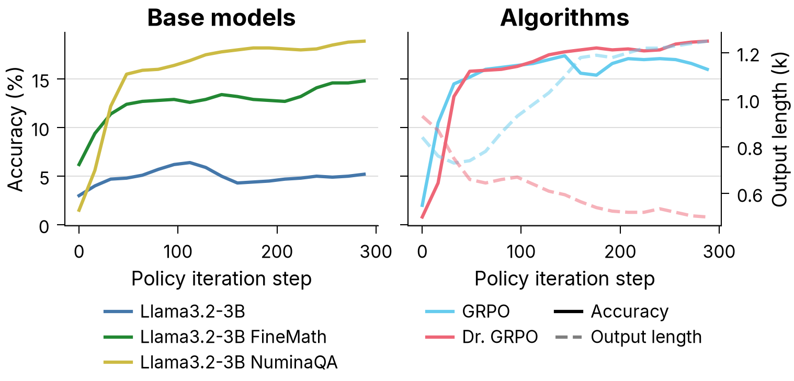 |
| 8 | 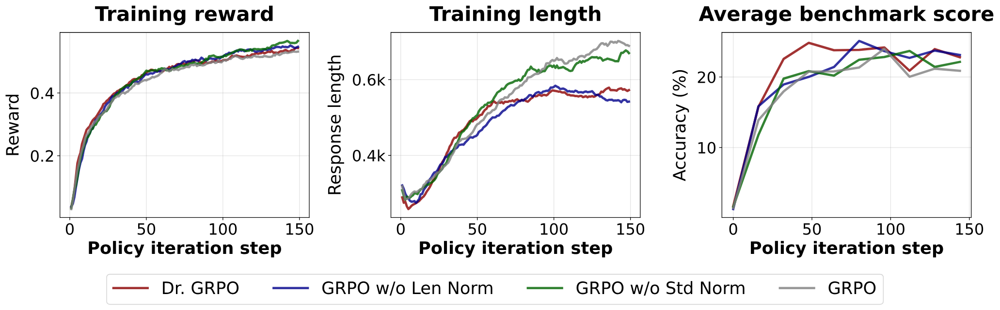 | 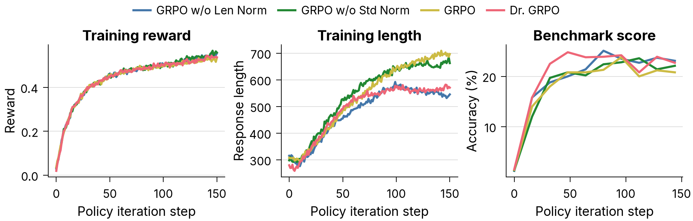 |
| 9 | 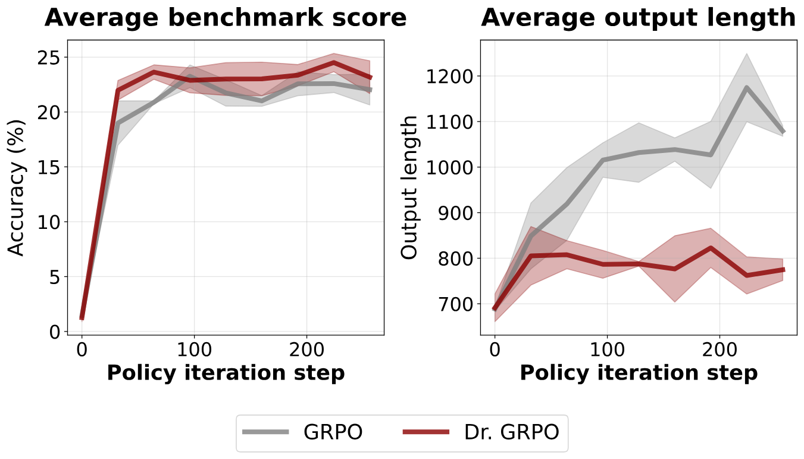 | 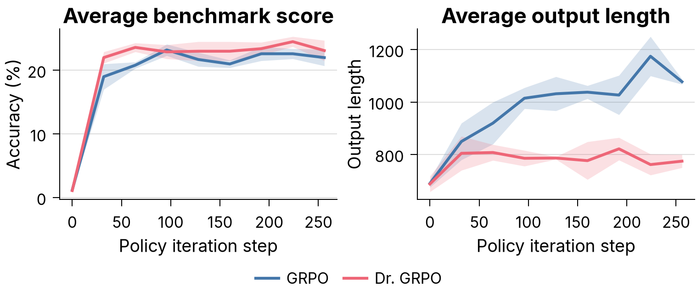 |
| 10 | 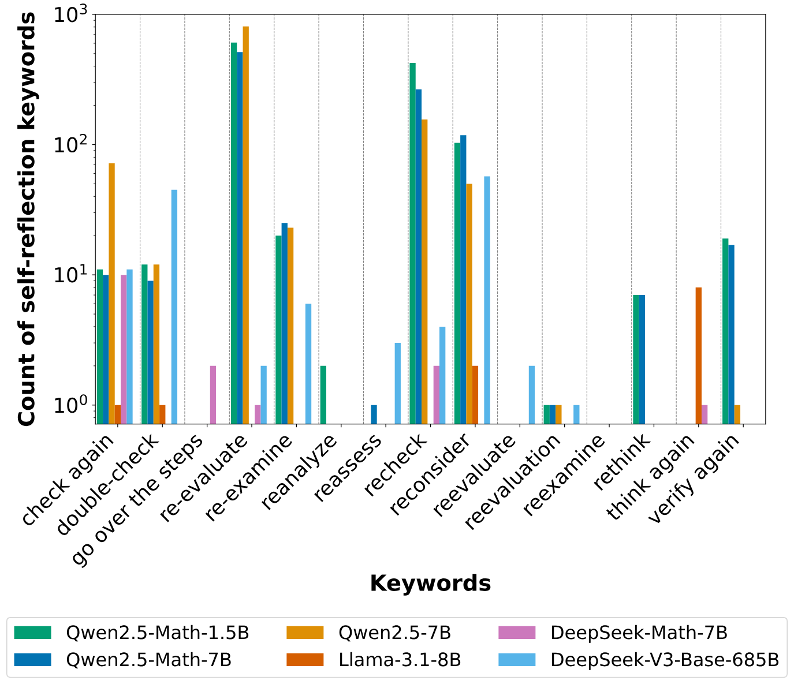 | 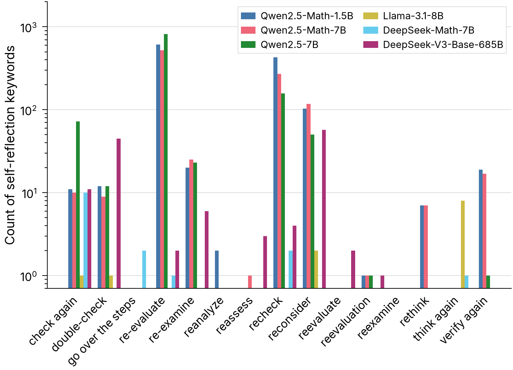 |
| 12 | 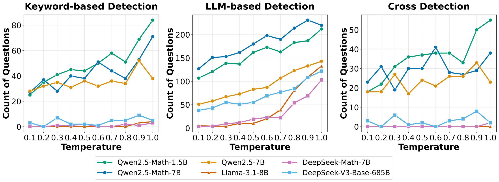 | 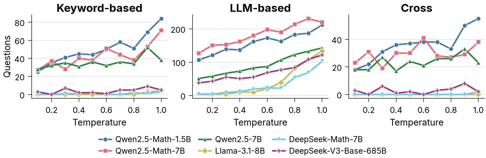 |
| 14 | 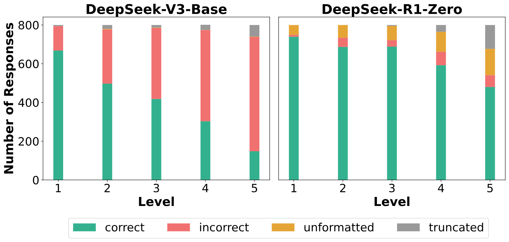 | 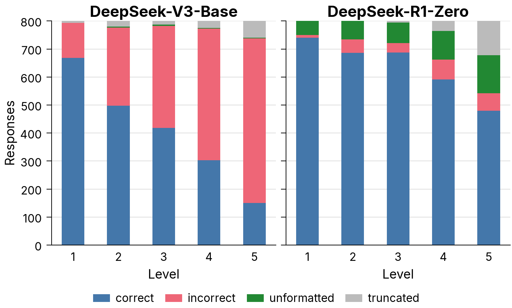 |
| 15 | 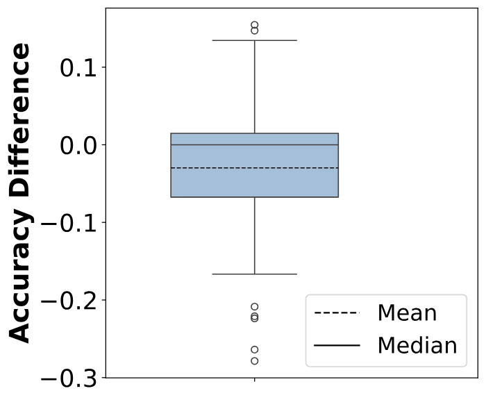 | 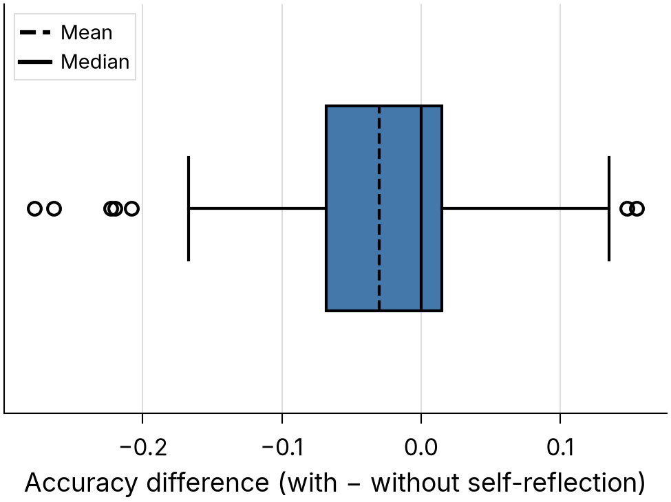 |
